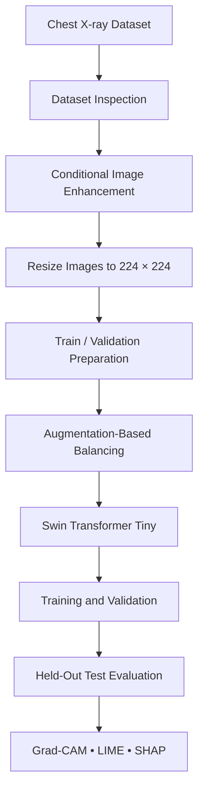

<div align="center">

# 🫁 Pneumonia Detection Using Swin Transformer

### Chest X-Ray Classification | Deep Learning | Explainable AI

<p>
  
  
  
  
</p>

**A deep-learning project for classifying chest X-ray images as NORMAL or PNEUMONIA.**

[📓 Open Notebook](./pneumonia-detection-balanced.ipynb) ·
[📦 Dataset](https://www.kaggle.com/datasets/paultimothymooney/chest-xray-pneumonia)

</div>

---

## 📌 Overview

This project investigates chest X-ray classification using **Swin Transformer Tiny**, supported by image preprocessing, training-set balancing, quantitative evaluation, and explainability techniques.

The notebook's workflow covers dataset inspection, conditional image enhancement, resizing, augmentation-based oversampling, model training, test evaluation, and visual explanations using Grad-CAM, LIME, and SHAP.

> **⚠️ Important:** This project is for educational and research purposes only. It is not a medical device and must not be used to diagnose, treat, or triage patients.

## ⭐ Highlights

- 🩻 **Two classes:** `NORMAL` and `PNEUMONIA`
- 🧹 **Image preprocessing:** quality checks, conditional denoising, CLAHE contrast enhancement, and resizing
- ⚖️ **Class balancing:** augmentation-based oversampling of training images
- 🧠 **Transformer architecture:** ImageNet-pretrained Swin Transformer Tiny
- 📊 **Evaluation:** accuracy, precision, recall, F1-score, and log loss
- 🔍 **Explainable AI:** Grad-CAM, LIME, and SHAP visualizations
- 🎯 **Reproducibility:** fixed random seed and documented hyperparameters

## 🧭 Workflow



## 📈 Results

The notebook's saved evaluation output reports the following results on a held-out test set of **624 images**.

| Metric | NORMAL | PNEUMONIA |
|:--|--:|--:|
| Precision | 0.85 | 0.85 |
| Recall | 0.72 | 0.93 |
| F1-score | 0.78 | 0.88 |
| Support | 234 | 390 |

| Overall metric | Reported result |
|:--|--:|
| **Test accuracy** | **84.94%** |
| Test log loss | 0.3423 |
| Macro-average F1-score | 0.83 |
| Weighted-average F1-score | 0.85 |

**Interpretation:** Recall is higher for PNEUMONIA than for NORMAL in these results. Some normal images may be incorrectly classified as pneumonia. These results describe this test split only; they do not establish clinical performance or generalization to other populations.

## 🗃️ Dataset

**Dataset:** [Chest X-Ray Images (Pneumonia) — Kaggle](https://www.kaggle.com/datasets/paultimothymooney/chest-xray-pneumonia)

The dataset contains chest X-ray images organized into two classes:

- `NORMAL`
- `PNEUMONIA`

The notebook reports scanning **5,856 images**, with a prepared split of **4,708 training**, **524 validation**, and **624 test** images. Counts may differ depending on the dataset copy and preparation steps.

Expected folder structure:

```text
chest_xray/
├── train/
│   ├── NORMAL/
│   └── PNEUMONIA/
├── val/
│   ├── NORMAL/
│   └── PNEUMONIA/
└── test/
    ├── NORMAL/
    └── PNEUMONIA/
```

The dataset is not included in this repository. Download it from Kaggle and make it available in your notebook environment. Adjust the dataset path if necessary.

## 🧰 Tech Stack

| Component | Tools |
|:--|:--|
| Language | Python |
| Deep learning | PyTorch, Torchvision |
| Image processing | OpenCV, Pillow |
| Data handling | NumPy, Pandas |
| Visualization | Matplotlib, Seaborn |
| Metrics | scikit-learn |
| Explainability | Grad-CAM, LIME, SHAP |
| Notebook environment | Google Colab / Kaggle |

## 🚀 Getting Started

### Option 1: Google Colab

1. Download or clone this repository.
2. Open `pneumonia-detection-balanced.ipynb` in Google Colab.
3. Download the dataset from [Kaggle](https://www.kaggle.com/datasets/paultimothymooney/chest-xray-pneumonia).
4. Make the dataset folders accessible to the notebook.
5. Update the dataset path if needed.
6. Select a GPU runtime if available and run the notebook cells in order.

### Option 2: Local Environment

Install the main dependencies:

```bash
pip install torch torchvision opencv-python numpy pandas matplotlib seaborn scikit-learn pillow tqdm grad-cam lime shap
```

Use a PyTorch and Torchvision build compatible with your Python and CUDA versions. Then open the notebook in Jupyter and check that the dataset path is correct.

## ⚙️ Model Configuration

| Parameter | Value |
|:--|:--|
| Model | Swin Transformer Tiny |
| Initial weights | ImageNet-pretrained |
| Input size | 224 × 224 |
| Batch size | 32 |
| Learning rate | 0.0001 |
| Epochs | 5 |
| Optimizer | Adam |
| Trainable component | Final classification head |
| Random seed | 42 |
| Number of classes | 2 |

## 🔎 Explainability

| Technique | What it helps inspect |
|:--|:--|
| **Grad-CAM** | Image regions associated with a model output |
| **LIME** | Local influence of image segments on a prediction |
| **SHAP** | Estimated contributions of input features to model output |

Explainability visualizations are exploratory tools. They do not prove that a prediction is correct or that the model is relying on clinically valid evidence.

## 📁 Repository Structure

```text
pneumonia-detection-swin-transformer/
├── README.md
└── pneumonia-detection-balanced.ipynb
```

## ⚠️ Limitations & Responsible Use

- Results are based on one held-out dataset split; external validation is not reported here.
- Model performance may change across hospitals, scanners, patient populations, and imaging protocols.
- Differences in class-wise recall mean accuracy alone is not enough to evaluate the model.
- Explainability maps may be unstable or misleading.
- **Do not use this project for diagnosis, treatment, triage, or other clinical decisions.**

## 🔮 Future Improvements

- Compare against a CNN baseline and fine-tune selected transformer layers.
- Add a confusion matrix, ROC-AUC, PR-AUC, sensitivity, specificity, and confidence intervals.
- Validate using an independent dataset and investigate possible patient-level data leakage.
- Add an inference script and pinned dependency versions.
- Review explanations with qualified domain experts.

## 📚 Dataset Credit

Please review and follow the dataset's terms of use.

- Kermany et al., *Identifying Medical Diagnoses and Treatable Diseases by Image-Based Deep Learning*. **Cell (2018)**.
- [Chest X-Ray Images (Pneumonia) — Kaggle](https://www.kaggle.com/datasets/paultimothymooney/chest-xray-pneumonia)

---

<div align="center">

**Built for learning, experimentation, and responsible AI research.**

⭐ If this repository is useful to you, consider giving it a star.

</div>
